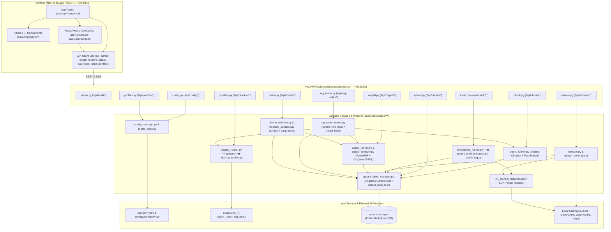

# Pipeline Player

[](https://www.gnu.org/licenses/gpl-3.0)

A localhost web application for **testing, configuring, and benchmarking Docling and ColPali document ingestion pipelines**.

Pipeline Player is a GUI wrapper for Docling v2 and ColPali/ColQwen2, designed to make tuning complex AI document parsing and visual retrieval pipelines intuitive, fast, and reproducible — without writing a single line of code.

---

## Features

| Feature | Description |
|---|---|
| **Real-Time Progress & ETA** | SSE-based live progress bar with estimated completion time |
| **Pipeline Cancellation** | Gracefully terminate heavy pipeline workers at any time |
| **Hardware Fallback** | Automatically falls back from MPS to AUTO for unsupported VLMs |
| **Full Docling Coverage** | Every `PdfPipelineOptions` parameter exposed in the UI |
| **Annotated HTML Output** | Bounding box overlays rendered over page images |
| **Config Profiles** | Named YAML profiles with auto-save (debounced 300 ms) |
| **Reproducible Runs** | Full config snapshot + timing log saved per run |
| **ColPali Visual Retrieval** | Page-level multi-vector embeddings via ColQwen2 |
| **Hybrid RAG** | Dense + Sparse (BM25) retrieval with RRF/DBSF fusion |
| **Graph RAG** | Entity/relationship extraction with community summaries |
| **Download Settings** | Export any pipeline's active settings as annotated Markdown |

---

## Architecture

```
pipeline-player/
├── backend/           # FastAPI (Python) — pipeline execution + SSE streaming
│   ├── routers/       # Per-stage API endpoints
│   ├── services/      # Pipeline business logic
│   └── main.py        # App entry point, router registration
├── frontend/          # Next.js 16 (React/TypeScript) — UI
│   └── src/
│       ├── app/       # Page routes (one folder per pipeline stage)
│       ├── components/# Shared UI components
│       ├── hooks/     # SSE streaming hooks (useRunStream, useChunkStream, …)
│       └── lib/       # API client helpers + settings export utility
├── configs/           # Saved profiles (git-ignored): Docling *.yaml, chunk/, colpali/, reranker/
└── test_data/         # Place your PDFs here (git-ignored)
```

---

## Prerequisites

Install these **before** running `pip install`:

| Tool | Version | Notes |
|---|---|---|
| **Python** | 3.10 – 3.12 | 3.12 recommended (best ONNX/MPS compatibility) |
| **Node.js** | 18+ | With npm |
| **Ollama** | latest | Required for RAPTOR, Graph RAG, and local LLM answer generation |
| **git** | any | For cloning |

> **Apple Silicon (M-series):** MPS acceleration works out-of-the-box. Ensure Xcode Command Line Tools are installed.

---

## Installation

### 1 — Clone the repository

```bash
git clone https://github.com/YOUR_USERNAME/pipeline-player.git
cd pipeline-player
```

### 2 — Add your documents

```bash
# Place any PDF you want to process into test_data/
cp /path/to/your-document.pdf test_data/
```

> **Looking for test documents?** The [ViDoRe Benchmark v3](https://huggingface.co/collections/vidore/vidore-benchmark-v3) collection on HuggingFace contains a curated set of scientific and university-level PDFs — ideal for benchmarking visual retrieval quality.

### 3 — Python virtual environment & backend

```bash
# Create and activate a virtual environment
python3 -m venv .venv
source .venv/bin/activate       # macOS / Linux
# .venv\Scripts\activate        # Windows

# Install all backend dependencies
pip install -r backend/requirements.txt
```

> **Model downloads on first use:** Pipeline Player pulls model weights automatically the first time each stage is used. The models listed below are the **defaults** — most can be swapped for alternatives in the UI. Plan for ~7–15 GB total for a full local setup:
>
> | Stage | Default Model | Size | When |
> |---|---|---|---|
> | Docling Parser | Layout + Table + OCR models | ~1–2 GB | First pipeline run |
> | Chunk & Vectorize | fastembed BGE-Small (dense) + BM25 | ~130 MB | First chunk run |
> | ColPali Pipeline | ColQwen2 v1.0 via HuggingFace | ~5 GB | First ColPali run |
> | Enrichment (RAPTOR/Graph RAG) | Any Ollama text model, e.g. `llama3.2` | ~2 GB | `ollama pull` — manual |
> | Answer Generation (local) | Any Ollama vision model, e.g. `llava` | ~4 GB | `ollama pull llava` — manual |
>
> Cloud-based answer generation (Gemini, GPT-4o) has no local download — only an API key is needed.

### 4 — PyTorch (required for ColPali)

PyTorch must be installed separately because the correct build depends on your hardware:

```bash
# Apple Silicon (MPS) — standard PyPI build:
pip install torch torchvision

# NVIDIA GPU (CUDA 12.1):
pip install torch torchvision --index-url https://download.pytorch.org/whl/cu121

# CPU only (slow, no GPU):
pip install torch torchvision --index-url https://download.pytorch.org/whl/cpu
```

### 5 — Environment variables (API keys)

```bash
# Copy the template and fill in your keys
cp backend/.env.example backend/.env
```

Edit `backend/.env`:

```dotenv
# Required for Gemini answer generation (get yours at https://ai.studio)
GEMINI_API_KEY="your-key-here"

# Optional — only needed for GPT-4o answer generation
OPENAI_API_KEY=""
```

> **Note:** `.env` is git-ignored and will never be committed.

### 6 — Frontend

```bash
cd frontend
npm install
cd ..
```

---

## Running locally

Open **two terminals** from the project root:

**Terminal 1 — Backend:**
```bash
source .venv/bin/activate
cd backend
uvicorn main:app --reload --port 8000 --env-file .env
```

**Terminal 2 — Frontend:**
```bash
cd frontend
npm run dev
```

Open **http://localhost:3000** in your browser.  
FastAPI interactive docs: **http://localhost:8000/api/docs**

---

## Pipeline Stages & On-Demand Dependencies

Each stage is independent. Nothing beyond `pip install -r requirements.txt` is needed just to start the app — additional models and services are fetched automatically or pulled manually the first time a stage is used.

---

### Step 1 — Docling Parser

Parse PDFs with full parameter control. Docling model weights (~1–2 GB) are downloaded automatically on first run into HuggingFace's default cache (`~/.cache/huggingface/`).

**OCR engines.** RapidOCR (bundled) and macOS Vision (`ocrmac`) work out of the box. If the selected engine is not installed, the backend falls back to RapidOCR and writes a `⚠` line into the run log. The recognition languages from the UI are forwarded to every engine in its own format: macOS Vision `de`→`de-DE`, Tesseract `de`→`deu`, RapidOCR uses the first language only.

```bash
# EasyOCR — GPU-accelerated, downloads ~300 MB model on first use
pip install easyocr

# Tesseract (Python bindings used by Docling's "tesseract" engine)
brew install tesseract && pip install tesserocr
# Tesseract CLI engine only needs the binary:
brew install tesseract
```

> [!NOTE]
> "OCRmyPDF" is listed for completeness but is not a Docling OCR engine; it runs as RapidOCR.

**Picture description (VLM captions).** Turn on *Generate Picture Captions* and pick the model under *Enrichment Models → VLM Backend*. Both controls stay in sync, and the toggle is the master switch. The generated descriptions are part of the chunk text in Step 2 and the RAG Tester.

| Backend | Model | Size (first download) |
|---|---|---|
| `smolvlm` | HuggingFaceTB/SmolVLM-256M-Instruct (Docling default) | ~0.5 GB |
| `granite_vision` | ibm-granite/granite-vision-3.3-2b | ~5 GB |
| `qwen` | Qwen/Qwen2.5-VL-3B-Instruct | ~7 GB |
| `pixtral` | mistral-community/pixtral-12b | ~25 GB |
| `api` | any OpenAI-compatible endpoint, e.g. Ollama `http://localhost:11434/v1/chat/completions` with `llama3.2-vision` / `llava` | — |

For `api`, *Allow Remote Services* is switched on automatically. An API key is read from the env var named in *API Key Env Var*, and only that variable's name is stored in the profile. The run log shows which model was actually used.

*Classify Pictures* uses DocumentFigureClassifier-v2.5. *Chart Data Extraction* uses granite-vision-v4 and enables classification automatically, because only pictures classified as charts are processed.

---

### Step 2 — Chunk & Vectorize

Chunks Docling output, embeds it, and upserts into a local Qdrant collection.

- **Qdrant** runs in local file mode (stored in `qdrant_storage/`) — no Docker needed.
- **fastembed** auto-downloads embedding models on first use into `~/.cache/fastembed`. The backend sets `FASTEMBED_CACHE_PATH` at startup; fastembed's default, the macOS temp dir, gets purged by the OS. You can override the path in `backend/.env`.
  - BGE-Small-EN-v1.5 (dense, ~130 MB)
  - BM25 (sparse, negligible size)
- **Include captions in text** (Serialization) removes figure/table captions from the chunk text when switched off.

---

### Step 3 — Vector DB Inspector

Browse and filter any Qdrant collection. No additional dependencies.

---

### Step 4 — Enrich Collection (RAPTOR & Graph RAG)

Requires **Ollama** running locally with at least one text generation model:

```bash
# Install Ollama from: https://ollama.com/download
# Then pull a model:
ollama pull llama3.2       # recommended — 2 GB, fast
ollama pull gemma3:4b      # alternative — good quality
```

Ollama must be running before you start the backend:
```bash
ollama serve   # starts automatically on macOS if installed via the app
```

---

### Step 5 — Retrieval & Answer Generation

Hybrid dense + sparse RAG search over Qdrant. No extra setup beyond Step 2.

> [!NOTE]
> Step 5 picks the dense query model from the collection's vector size (384 → BGE-Small, …), not from the model stored in the payload. Size-ambiguous collections (e.g. 768-dim jina vs. e5-base) can therefore be queried with the wrong model. The **Fusion Retriever** reads the stored model and lets you override it.

**For answer generation**, choose your model:

| Model | Setup |
|---|---|
| **Gemini Flash / Pro** | Set `GEMINI_API_KEY` in `backend/.env` |
| **GPT-4o / GPT-4o Mini** | Set `OPENAI_API_KEY` in `backend/.env` |
| **Ollama Llama 3.2 (text)** | Ollama running with `llama3.2` pulled |
| **Ollama LLaVA (vision)** | `ollama pull llava` (~4 GB) |

---

### ColPali — Visual Retrieval Pipeline

A parallel, image-first pipeline that processes entire PDF pages as visual embeddings. Runs alongside Steps 1–5 independently.

**Sub-stages:**

| Tab | Route | Purpose |
|---|---|---|
| **ColPali: Process** | `/colpali` | Rasterize PDF → encode pages with ColQwen2 → upsert to Qdrant |
| **ColPali: Retrieve** | `/colpali/retrieve` | MaxSim retrieval + optional vision-model answer generation |

**Setup:** PyTorch (see Installation Step 4) + the ColQwen2 model (~5 GB, auto-downloaded from HuggingFace on first pipeline run).

```bash
# For visual answer generation on ColPali results:
ollama pull llava
```

---

### RAG Tester — Whole Course Folder → Two Collections

Builds **two complete Qdrant collections for a whole folder of PDFs** (e.g. one course) in a single run, re-using your proven, saved settings:

| Collection | Built from | Search | Used in |
|---|---|---|---|
| `<course>_hybrid` | Docling profile (Step 1) → chunk profile (Step 2) → dense + sparse | Hybrid / RRF | Step 4 Enrich, Step 5 Retrieval |
| `<course>_colpali` | ColPali process profile → page images → ColQwen2 multi-vectors | MaxSim late interaction | ColPali: Retrieve |

- The **text track** parses several PDFs in parallel (configurable Docling workers, ~2–3 GB RAM each). Each document is chunked, embedded and upserted as soon as its parse finishes.
- The **visual track** runs at the same time. It loads the ColPali model **once** and encodes the documents one after another.
- Every point in **both** collections carries the same metadata: `doc_name`, `file_path`, `rel_path`, `course`, `doc_source` and the page (`page_numbers` / `page_start` for chunks, `page_number` for ColPali pages), plus optional custom fields.
- Only PDFs are ingested, so that both collections contain exactly the same documents.

**Prerequisites:** at least one saved **chunk profile** (Step 2 → 💾 Profile bar) and one saved **ColPali profile** (ColPali: Process → 💾 Profile bar). No extra installation is needed beyond Steps 1, 2 and ColPali.

---

### Fusion Retriever — Hybrid + MaxSim + Your Own Reranker

Queries a **text collection** (hybrid dense + sparse, Qdrant RRF) and a **ColPali collection** (MaxSim) with the same question, in parallel. A small **Python reranker** that you write in the browser merges both lists. The final top-k items that would go to the LLM update live while you edit the code.

- **Model detection.** The dense model of a text collection is read from the point payload (`dense_model` / `sparse_model`, written by Step 2 and the RAG Tester). For older collections it comes from the RAG Tester manifest. As a last resort it is guessed from the vector size; such guesses show a warning chip and can be overridden.
- **Model dropdowns.** The dense and sparse query models can be overridden from dropdowns filled by the installed fastembed version. Only dense models with the collection's vector size can be selected. A warning appears if you pick a model other than the one used for indexing.
- **Text fusion.** The dense and sparse lists of the text collection can be merged in four ways, all computed by Qdrant:
  - **RRF** with adjustable `k` and per-list weights. Qdrant scores `Σ 1 / (rank / w + k − 1)`, so the weight divides the rank.
  - **DBSF**: scores normalised to mean ± 3σ, then summed.
  - **Dense only** or **sparse only**.
- **Transparency.** Every text candidate shows its rank in the dense and the sparse list, how much of its fused score came from each list (blue/amber bar), and a badge: *dense-driven* (≥ 60 %), *sparse-driven* (≤ 40 %), *both*, or *only dense/sparse* if just one retriever found it. These shares are recomputed with the same formulas as qdrant-client and add up to Qdrant's fused score.
- **Reranker contract.** The script must define the function below. Every hit is a dict with:
  - `source` (`"text"` / `"colpali"`), `id`, `rank`, `score`, `score_norm` (0..1 within its list), `doc_name`, `file_path` and page fields;
  - for text hits also `text`, `dense_rank`/`dense_score`, `sparse_rank`/`sparse_score`, `dense_contrib`/`sparse_contrib`, `dense_share`, `found_by` and `driver`.

  Returned hits may add `fused_score` and `reason`, which are shown in the UI.

  ```python
  def rerank(text_hits: list[dict], colpali_hits: list[dict], k: int) -> list[dict]:
      ...
  ```

- **Sandbox.** The script runs in a separate, isolated Python process (`python -I`) with a 3-second timeout. `print()` output is shown below the editor, and syntax or runtime errors highlight the affected line.
- **Saved scripts** are stored as `configs/reranker/<name>.py`. Like all of `configs/`, this folder is git-ignored. The built-in default is weighted RRF (`k = 60`), with a commented-out example rule: *"if ColPali #1 scores ≥ 30 % higher than ColPali #2, put it first"*.
- **Generate answer** uses the same models as ColPali: Retrieve. Text chunks are sent as text, ColPali pages as page images, each labelled `[Source N]`.

> [!WARNING]
> The reranker runs **arbitrary Python code on your machine**. The timeout guards against endless loops, but the process is not a security sandbox. Keep the backend bound to `localhost` and only run scripts you trust.

---

## Using the UI

### Tab Navigation

| Tab | Route | Pipeline Step |
|---|---|---|
| **📄 Step 1: Docling Parser** | `/` | Parse PDFs with full parameter control |
| **✂️ Step 2: Chunk & Vectorize** | `/chunk` | Chunk → embed → upsert into Qdrant |
| **🔍 Step 3: Vector DB Inspector** | `/inspector` | Browse & filter any Qdrant collection |
| **🧠 Step 4: Enrich Collection** | `/enrich` | RAPTOR summarisation + Graph RAG |
| **🔎 Step 5: Retrieval** | `/retrieve` | Hybrid RAG search + answer generation |
| **🖼️ ColPali: Process** | `/colpali` | Visual page-level embedding pipeline |
| **🔎 ColPali: Retrieve** | `/colpali/retrieve` | MaxSim retrieval + visual answer generation |
| **🧪 RAG Tester** | `/rag-tester` | Whole folder → hybrid + ColPali collections in one run |
| **🔀 Fusion Retriever** | `/fusion` | Hybrid + MaxSim in parallel, custom Python reranker, answer generation |

---

### Step 1 — Docling Parser

- Every parameter has a **?** tooltip explaining its effect.
- Changes auto-save to the active YAML profile (debounced 300 ms).
- Use **💾 Save As** to create named profiles, **🗑** to delete.
- Select a document from the dropdown and click **▶ Run Pipeline**.
- Watch the live progress bar and log console — cancel at any time with **■ Cancel**.
- When complete, switch between output tabs (HTML, Markdown, JSON) in the center panel.
- HTML output renders with high-fidelity bounding box overlays directly in the browser.

### Step 2 — Chunk & Vectorize

- Select the source Docling run from the dropdown.
- Configure the chunker (Hybrid/Hierarchical/Page), embedding mode (Dense/Sparse/Hybrid), and Qdrant collection settings.
- Use the **💾 Profile** bar to save proven chunking + embedding settings (`configs/chunk/<name>.yaml`) for re-use in the RAG Tester. The source run and collection name are not stored in the profile.
- Click **▶ Run Chunk Pipeline** — progress streams live.
- The resulting Qdrant collection is immediately available in Steps 3–5.

### Step 3 — Vector DB Inspector

- Select any Qdrant collection.
- Filter by chunk type, element type, and custom metadata.
- Inspect individual chunks and their embedding metadata.

### Step 4 — Enrich Collection

- Select a collection chunked in Step 2.
- Run **RAPTOR** to add hierarchical summary nodes, or **Graph RAG** to extract entities and relationships.
- Requires Ollama running locally (see Prerequisites).

### Step 5 — Retrieval & Answer Generation

- Select a collection, enter a natural language question.
- The backend rewrites the query, runs hybrid search (RRF/DBSF fusion), and shows ranked results.
- Click **▶ Generate Answer** to stream a grounded AI answer using your selected model.

### ColPali: Process

- Select a PDF from `test_data/`.
- Configure model (`colqwen2-v1.0` or `colpali-v1.3`), device, DPI, and batch size.
- Use the **💾 Profile** bar to save these process settings (`configs/colpali/<name>.yaml`) for re-use in the RAG Tester.
- Click **▶ Run ColPali Pipeline** — pages are rasterized, encoded, and upserted as multi-vector points.
- Click **⬇ Download Settings** to save the current configuration as annotated Markdown.

### ColPali: Retrieve

- Select a ColPali collection.
- Enter a query — MaxSim scoring ranks pages by visual similarity.
- Click **▶ Generate Answer** to run visual answer generation using Gemini, GPT-4o, or LLaVA.

### RAG Tester

1. **Course folder.** Pick a sub-folder of `test_data/` or type any path (`/abs/path`, `~/path`). A preview lists every PDF with its page count.
2. **Profiles.** Choose the Docling, chunk and ColPali profiles. *Force hybrid embedding* (on by default) always stores dense + sparse vectors. Either track can be switched off.
3. **Collections.** Names are suggested from the folder name and can be edited. If a collection already exists, the run stops unless **Overwrite** is ticked.
4. **Parallel Docling workers.** Default is 3. Optionally add extra metadata (e.g. `semester: FS13`), which is written into both collections.
5. Click **🧪 Build both collections**. The table shows the live status of every document in both tracks. Failed documents are reported and skipped; the rest continue.

Keep the tab open during the run. Closing it cancels the run.

### Fusion Retriever

1. **Query and collections.** Enter a question. When you pick a `<course>_hybrid` collection, its `<course>_colpali` sibling is selected automatically. Either side can be set to *none*.
2. **Limits.** Set top-N per list (default 5) and *→ LLM (k)*, the number of items passed to the model (default 3).
3. Click **🔎 Search both** (or press ⌘/Ctrl + Enter). The first search loads the models (~15–30 s); later searches take well under a second. The candidates appear side by side, with ColPali pages as thumbnails (click to enlarge).
4. **Edit the reranker** on the right (CodeMirror editor with Python syntax highlighting). It re-runs about 400 ms after every change. Selected candidates get a **→ LLM #n** badge. Save proven scripts with **💾**, or go back to the built-in RRF with **↺ RRF**.
5. When the ranking looks right, click **▶ Generate answer**.

### Download Settings

Each pipeline page has a **⬇** button (Docling: in the profile toolbar; ColPali: below the Run button) that exports the current configuration as an annotated Markdown file — useful for documenting experiments and sharing reproducible setups.

---

## Outputs & Reproducibility

Every Docling run saves to `outputs/run_{YYYYMMDD_HHMMSS}_{profile}/`:

```
outputs/run_20240901_143022_default/
├── parsed_doc.html     # Split-page view with bounding box overlays
├── parsed_doc.md       # Markdown output
├── parsed_doc.json     # Full DoclingDocument JSON
├── config.yaml         # Exact config snapshot used for this run
└── run.log             # Timing, page count, warnings
```

> `outputs/` and `qdrant_storage/` are **git-ignored** and stay local.

Every **RAG Tester** run additionally writes:

```
outputs/rag_{run_id}/run_01_<doc>/   # Docling outputs per document (parsed_doc.json, config.yaml, run.log)
rag_runs/{run_id}.json               # Manifest: request, full copies of all 3 profiles, collections, per-document results
```

> `rag_runs/` is git-ignored as well.

---

## Tech Stack

| Layer | Technology |
|---|---|
| **Backend** | FastAPI, Uvicorn, Python 3.12, Multiprocessing |
| **Document Parsing** | Docling v2, docling-core |
| **Visual Retrieval** | ColQwen2 / ColPali (via sentence-transformers MultiVectorEncoder) |
| **Vector DB** | Qdrant (local file mode) with fastembed |
| **Embeddings** | fastembed: BGE-Small-EN-v1.5 (dense, default) + BM25 (sparse); any other fastembed model selectable per chunk profile |
| **LLM / Enrichment** | Ollama (local), OpenAI, Google Gemini |
| **Frontend** | Next.js 16 (App Router), TypeScript |
| **Styling** | Vanilla CSS — custom dark theme, no Tailwind |
| **Config** | Pydantic v2 ↔ YAML |

---

## Docling Parameters Reference

All parameters map directly to Docling's `PdfPipelineOptions`:  
https://docling-project.github.io/docling/reference/pipeline_options/

| Section | Key Parameters |
|---|---|
| **Core** | `do_ocr`, `do_table_structure`, `do_chart_extraction`, `do_code_enrichment`, `do_formula_enrichment`, `do_picture_classification`, `do_picture_description` |
| **Output** | `formats`, `html_split_page_view`, `html_include_annotations` |
| **OCR** | `ocr_options.kind`, `lang`, `force_full_page_ocr`, `bitmap_area_threshold` |
| **Tables** | `table_structure_options.mode`, `do_cell_matching` |
| **Images** | `generate_page_images`, `generate_picture_images`, `images_scale` |
| **Layout** | `layout_options.model` |
| **Headings** | `heading_hierarchy_options` |
| **Enrichment** | `picture_description_options` (VLM preset or API, prompt, area threshold), `picture_classification_options`, `code_formula_options`, `chart_extraction_options` |
| **Accelerator** | `accelerator_options.device`, `num_threads` |
| **Performance** | `layout_batch_size`, `ocr_batch_size`, `table_batch_size`, `queue_max_size` |

---

## License

Copyright (C) 2026 olischn

This program is free software: you can redistribute it and/or modify it under the terms of the **GNU General Public License version 3** as published by the Free Software Foundation.

See [`LICENSE`](LICENSE) for the full license text.

### Dependency Licenses

Pipeline Player uses the following key open source libraries:

| Library | License | Notes |
|---|---|---|
| [Docling](https://github.com/docling-project/docling) | MIT | IBM document parser |
| [PyMuPDF](https://github.com/pymupdf/PyMuPDF) | GNU AGPL-3.0 | PDF rasterizer — AGPL applies to network distribution |
| [sentence-transformers](https://github.com/UKPLab/sentence-transformers) | Apache 2.0 | ColPali/ColQwen2 model loader |
| [PyTorch](https://github.com/pytorch/pytorch) | BSD-3-Clause | ML inference backend |
| [Qdrant client](https://github.com/qdrant/qdrant-client) | Apache 2.0 | Vector DB client |
| [FastAPI](https://github.com/tiangolo/fastapi) | MIT | Backend framework |
| [Transformers](https://github.com/huggingface/transformers) | Apache 2.0 | HuggingFace model hub |
| [PEFT](https://github.com/huggingface/peft) | Apache 2.0 | LoRA adapter support |
| [Next.js](https://github.com/vercel/next.js) | MIT | Frontend framework |
| [scikit-learn](https://github.com/scikit-learn/scikit-learn) | BSD-3-Clause | RAPTOR clustering |
| [NetworkX](https://github.com/networkx/networkx) | BSD-3-Clause | Graph RAG |

---

## Codebase Architecture & Complete Function Reference

This section documents the internal architecture of **Pipeline Player**, every module, class, and function across the Backend (`backend/`, `configs/reranker/`) and Frontend (`frontend/src/`), and how they call and interact with each other.

### 1. System Architecture & Call Graph

Pipeline Player follows a strict **4-layer architecture**:

1. **Frontend Pages (`frontend/src/app/**/page.tsx`) & Shared UI Components (`frontend/src/components/**`)** — Render the 9 interactive pipeline stages, manage local view state, and respond to user actions.
2. **Frontend Hooks (`frontend/src/hooks/*.ts`) & API Client Libraries (`frontend/src/lib/*.ts`)** — Encapsulate REST calls (`fetch`) and Server-Sent Events (SSE) streams (`ReadableStream`), managing `AbortController` lifecycles and debounced auto-saves.
3. **FastAPI Routers (`backend/routers/*.py`) & Pydantic Schemas (`backend/models/*.py`)** — Validate incoming JSON payloads/query parameters, map domain exceptions to HTTP status codes, and wrap generator services in `StreamingResponse` SSE endpoints.
4. **Backend Services, Enrichers & Isolated Workers (`backend/services/**/*.py`)** — Execute document parsing (`docling_worker.py` subprocess), chunking & FastEmbed vectorization (`chunk_runner.py`), ColPali multi-vector encoding (`colpali_runner.py`), hierarchical/graph enrichment (`enrichment_runner.py` + `enrichers/*`), hybrid/visual/fusion retrieval (`retriever.py`, `colpali_retriever.py`, `fusion_retriever.py`), sandboxed Python reranking (`reranker_sandbox.py`), and grounded answer generation (`answer_generator.py`), synchronized against local on-disk Qdrant via `qdrant_client_manager.py`.



---

### 2. Backend Reference (`backend/` & `configs/reranker/`)

#### 2.1 Application Entry Point (`backend/main.py`)

| Symbol | Kind | Called By | Calls | Description & Return Value |
|---|---|---|---|---|
| `on_startup()` | `async def` | FastAPI lifespan (`@app.on_event("startup")`) | `config_manager.ensure_default_profile()` | Runs at server boot after `.env` and `FASTEMBED_CACHE_PATH` are initialized; ensures `configs/default.yaml` exists and prints readiness status. Returns `None`. |

---

#### 2.2 Pydantic Data Models & Schemas (`backend/models/*.py`)

##### `backend/models/config_schema.py` (Step 1 Docling Configuration)
- **`OcrEngine(str, Enum)`**: Enumerates OCR engines (`easyocr`, `rapidocr`, `tesseract`, `tesseract_cli`, `ocrmypdf`, `ocrmac`, `auto`). Used by `OcrOptions` and mapped by `docling_runner._build_docling_options()`.
- **`TableStructureMode(str, Enum)`**: Enumerates table parser modes (`fast`, `accurate`). Used by `TableStructureOptions`.
- **`AcceleratorDevice(str, Enum)`**: Enumerates PyTorch inference devices (`auto`, `cpu`, `cuda`, `mps`, `xpu`). Used by `AcceleratorOptions`.
- **`OutputFormat(str, Enum)`**: Enumerates export formats (`markdown`, `json`, `doctags`, `text`, `html`, `iterated_items`). Used by `OutputSettings`.
- **`PictureDescriptionKind(str, Enum)`**: Enumerates VLM figure captioning backends (`smolvlm`, `granite_vision`, `qwen`, `pixtral`, `api`, `disabled`). Used by `PictureDescriptionOptions`.
- **`PictureClassificationKind(str, Enum)`**: Enumerates figure classifier modes (`docling`, `disabled`). Used by `PictureClassificationOptions`.
- **`CodeFormulaKind(str, Enum)`**: Enumerates code/formula enrichment models (`granite`, `codeformulav2`, `disabled`). Used by `CodeFormulaOptions`.
- **`ChartExtractionKind(str, Enum)`**: Enumerates chart extraction modes (`docling`, `disabled`). Used by `ChartExtractionOptions`.
- **`LayoutModelKind(str, Enum)`**: Enumerates Docling layout detection presets (`default`, `layout_heron_default`, `layout_heron_101`, `layout_egret_medium`, `layout_egret_large`, `layout_egret_xlarge`). Used by `LayoutOptions`.
- **`ContentLayer(str, Enum)`**: Mirrors `docling_core` content layers (`body`, `furniture`, `background`, `invisible`, `notes`). Used by `IterateItemsOptions`.
- **`OcrOptions(BaseModel)`**: Validates `kind`, `lang`, `force_full_page_ocr`, and `bitmap_area_threshold`. Embedded in `PdfPipelineOptions`.
- **`TableStructureOptions(BaseModel)`**: Validates `mode` and `do_cell_matching`. Embedded in `PdfPipelineOptions`.
- **`AcceleratorOptions(BaseModel)`**: Validates `device` and `num_threads`. Embedded in `PdfPipelineOptions`.
- **`LayoutOptions(BaseModel)`**: Validates `model` (plus deprecated `keep_images`, `use_legacy_layout` for backward compatibility). Embedded in `PdfPipelineOptions`.
- **`HeadingHierarchyOptions(BaseModel)`**: Validates heading tree reconstruction parameters (`enabled`, `use_bookmarks`, `use_numbering`, `use_style`, `use_font_style`, `style_size_tolerance`, `max_level`, `bookmark_match_threshold`). Embedded in `PdfPipelineOptions`.
- **`PictureDescriptionOptions(BaseModel)`**: Validates VLM preset/API parameters (`kind`, `prompt`, `picture_area_threshold`, `api_url`, `api_model`, `api_key_env`, `api_timeout`, `api_concurrency`). Embedded in `PdfPipelineOptions` and consumed by `docling_runner._build_picture_description_options()`.
- **`PictureClassificationOptions(BaseModel)`**: Validates `kind`. Embedded in `PdfPipelineOptions`.
- **`CodeFormulaOptions(BaseModel)`**: Validates `kind`. Embedded in `PdfPipelineOptions`.
- **`ChartExtractionOptions(BaseModel)`**: Validates `kind`. Embedded in `PdfPipelineOptions`.
- **`PdfPipelineOptions(BaseModel)`**: Complete Pydantic mirror of Docling's native `PdfPipelineOptions` (core toggles, image rendering, batch sizes, queue tuning, and nested option models). Embedded in `PipelineConfig`.
- **`OutputSettings(BaseModel)`**: Validates `formats`, `html_split_page_view`, and `html_include_annotations`. Embedded in `PipelineConfig`.
- **`IterateItemsOptions(BaseModel)`**: Validates `with_groups`, `traverse_pictures`, `page_no`, and `included_content_layers`. Embedded in `PipelineConfig`.
- **`PipelineConfig(BaseModel)`**: Root Step 1 configuration model (`profile_name`, `description`, `pdf_options`, `output`, `iterate_items_options`). Exchanged between `routers/config.py`, `services/config_manager.py`, `services/docling_runner.py`, and `frontend/src/hooks/useConfig.ts`.

##### `backend/models/run_result.py` (Step 1 Execution Metadata)
- **`RunStatus(str, Enum)`**: Lifecycle status (`running`, `success`, `error`) of a Docling run.
- **`RunResult(BaseModel)`**: Metadata record (`run_id`, `profile_name`, `status`, `started_at`, `finished_at`, `duration_seconds`, `output_dir`, `output_files`, `page_count`, `error_message`, `warnings`) yielded by `docling_runner.run_pipeline()` and stored in `routers/pipeline.py::_run_history`.

##### `backend/models/chunk_schema.py` (Step 2 Chunking & Vectorization)
- **`ChunkerKind(str, Enum)`**: Supported Docling chunkers (`hybrid`, `hierarchical`, `page`).
- **`EmbeddingMode(str, Enum)`**: Vector storage modes (`dense`, `sparse`, `hybrid`).
- **`HybridChunkerOptions(BaseModel)`**: Validates `tokenizer_model`, `max_tokens`, `repeat_table_header`, `merge_peers`, `omit_header_on_overflow`, and `always_emit_headings`.
- **`HierarchicalChunkerOptions(BaseModel)`**: Validates `always_emit_headings` and `merge_list_items`.
- **`SerializationOptions(BaseModel)`**: Validates `include_headings_in_text` and `include_captions_in_text`.
- **`MetadataEnrichmentOptions(BaseModel)`**: Validates payload provenance flags (`add_doc_source`, `add_run_id`, `add_page_numbers`, `add_headings`, `add_element_types`, `add_token_count`) and `custom_fields`.
- **`EmbeddingOptions(BaseModel)`**: Validates `mode`, `dense_model`, `sparse_model`, and `batch_size`.
- **`QdrantOptions(BaseModel)`**: Validates `storage_path`, `collection_name`, `overwrite_collection`, and `on_disk_payload`.
- **`ChunkPipelineConfig(BaseModel)`**: Root Step 2 configuration model consumed by `routers/chunk.py`, `services/chunk_runner.py`, `services/profile_store.py`, and `services/rag_tester_runner.py`.

##### `backend/models/enrichment_schema.py` (Step 4 Collection Enrichment)
- **`EnrichStrategy(str, Enum)`**: Supported enrichment algorithms (`parent_child`, `raptor`, `graph_rag`).
- **`GraphBackend(str, Enum)`**: Knowledge graph persistence backends (`networkx`, `neo4j`).
- **`OllamaConfig(BaseModel)`**: Local Ollama connection parameters (`host`, `model`, `timeout_seconds`, `max_retries`).
- **`ParentChildOptions(BaseModel)`**: Validates `grouping_level`, `summary_max_tokens`, `summary_prompt_template`, `embed_summaries`, and `link_children`.
- **`RaptorOptions(BaseModel)`**: Validates `max_levels`, `umap_n_components`, `umap_n_neighbors`, `gmm_n_components`, and `summary_max_tokens`.
- **`GraphRagOptions(BaseModel)`**: Validates `graph_backend`, `neo4j_uri`, `neo4j_user`, `neo4j_password`, `max_entities_per_chunk`, `entity_types`, `run_community_detection`, and `community_summary_max_tokens`.
- **`EnrichmentConfig(BaseModel)`**: Root Step 4 request body sent to `POST /api/enrich/run` and consumed by `services/enrichment_runner.py::run_enrichment`.

##### `backend/models/retrieve_schema.py` & `backend/models/answer_schema.py` (Step 5 Retrieval & Answer Generation)
- **`RewriteRequest(BaseModel)`**: Wraps raw user `query` for `POST /api/retrieve/rewrite`.
- **`RewriteResponse(BaseModel)`**: Wraps LLM-extracted `rewritten_query`.
- **`RetrieveRequest(BaseModel)`**: Validates `collection_name`, `query`, `limit`, and `fusion_strategy` (`rrf` or `dbsf`) for `POST /api/retrieve/run`.
- **`RetrievedChunk(BaseModel)`**: Single ranked chunk (`id`, `score`, `text`, `metadata`).
- **`PrefetchResult(BaseModel)`**: Pre-fusion hit list (`using`, `chunks`) for dense/sparse inspection.
- **`RetrieveResponse(BaseModel)`**: Full Step 5 retrieval result (`rewritten_query`, `query_vectors`, `pre_fusion`, `fused_results`).
- **`AnswerRequest(BaseModel)`**: Request body (`query`, `chunks`, `model`, `image_references`, `prelabeled`) sent to `POST /api/retrieve/answer` by Step 5, ColPali Retrieve, and Fusion Retriever.
- **`AnswerResponse(BaseModel)`**: OpenAPI documentation model (`answer`) for grounded RAG answers.

##### `backend/models/colpali_schema.py` (ColPali Process & Retrieve)
- **`ColPaliConfig(BaseModel)`**: Full request body (`pdf_path`, `model_name`, `device`, `batch_size`, `dpi`, `max_pages`, `metadata`, `collection_name`, `qdrant_storage_path`) for `POST /api/colpali/run`.
- **`ColPaliProcessProfile(BaseModel)`**: Document-independent savable ColPali profile persisted in `configs/colpali/<name>.yaml` via `services/profile_store.py`.
- **`ColPaliRetrieveRequest(BaseModel)`**: Validates `collection_name`, `query`, and `limit` for `POST /api/colpali/retrieve`.
- **`ColPaliRetrievedPage(BaseModel)`**: Single MaxSim page hit (`id`, `score`, `page_number`, `doc_source`, `metadata`).
- **`ColPaliRetrieveResponse(BaseModel)`**: Response model (`query`, `results`) returned by `POST /api/colpali/retrieve`.

##### `backend/models/rag_tester_schema.py` (RAG Tester Batch Ingestion)
- **`FolderScanRequest(BaseModel)`**: Validates `folder_path` and `recursive` for `POST /api/rag-tester/scan`.
- **`RagTesterRequest(BaseModel)`**: Full dual-track batch ingestion configuration (`folder_path`, `recursive`, `docling_profile`, `chunk_profile`, `colpali_profile`, `enable_text_track`, `enable_visual_track`, `hybrid_collection`, `colpali_collection`, `overwrite`, `force_hybrid_embedding`, `docling_workers`, `custom_metadata`) for `POST /api/rag-tester/run`.

##### `backend/models/fusion_schema.py` (Fusion Retriever & Sandbox Reranker)
- **`FusionSearchRequest(BaseModel)`**: Dual-track search request (`query`, `text_collection`, `colpali_collection`, `text_limit`, `colpali_limit`, `dense_model_override`, `sparse_model_override`, `text_fusion`, `rrf_k`, `dense_weight`, `sparse_weight`) for `POST /api/fusion/search`.
  - **`FusionSearchRequest._none_to_empty(cls, v)`**: `@field_validator(mode="before")` that coerces JSON `null` (`None`) values on optional string fields into `""`.
- **`RerankRequest(BaseModel)`**: Request body (`code`, `text_hits`, `colpali_hits`, `k`) for `POST /api/fusion/rerank`.
- **`RerankScript(BaseModel)`**: Request body (`code`) for `PUT /api/fusion/scripts/{name}`.

---

#### 2.3 FastAPI Routers (`backend/routers/*.py`)

| File & Function | HTTP Route | Called By (Frontend) | Calls (Backend Service) | Description & Return Value |
|---|---|---|---|---|
| **`status.py`** | | | | |
| `health()` | `GET /api/health` | `lib/api.ts::checkHealth` | — | Returns `200 OK` JSON `{"status": "ok", "service": "pipeline-player-backend"}`. |
| **`config.py`** | | | | |
| `get_profiles()` | `GET /api/config/profiles` | `lib/api.ts::listProfiles` | `config_manager.list_profiles()` | Lists all saved Step 1 Docling YAML profile names in `configs/`. |
| `get_profile(name)` | `GET /api/config/{name}` | `lib/api.ts::loadProfile` | `config_manager.load_profile(name)` | Loads and validates `configs/{name}.yaml` into a `PipelineConfig`. |
| `update_profile(name, config)` | `PUT /api/config/{name}` | `lib/api.ts::saveProfile` | `config_manager.save_profile(config)` | Debounced auto-save endpoint; writes `PipelineConfig` to `configs/{name}.yaml`. |
| `save_as_profile(config)` | `POST /api/config/save-as` | `lib/api.ts::saveAsProfile` | `config_manager.save_profile(config)` | Creates a new named profile under `configs/{config.profile_name}.yaml`. |
| `remove_profile(name)` | `DELETE /api/config/{name}` | `lib/api.ts::deleteProfile` | `config_manager.delete_profile(name)` | Deletes `configs/{name}.yaml` (blocks deleting `"default"` with HTTP 400). |
| **`profiles.py`** | | | | |
| `_http_error(exc)` | *(internal helper)* | `profiles.py` endpoints | — | Maps `FileNotFoundError` to HTTP 404 and validation errors to HTTP 400. |
| `list_profiles(kind)` | `GET /api/profiles/{kind}` | `lib/profiles.ts::listSavedProfiles` | `profile_store.list_profiles(kind)` | Lists saved `"chunk"` or `"colpali"` profile names in `configs/{kind}/`. |
| `get_profile(kind, name)` | `GET /api/profiles/{kind}/{name}` | `lib/profiles.ts::loadSavedProfile` | `profile_store.load_profile(kind, name)` | Loads and dumps a saved chunk/ColPali profile as JSON. |
| `put_profile(kind, name, data)` | `PUT /api/profiles/{kind}/{name}` | `lib/profiles.ts::saveSavedProfile` | `profile_store.save_profile(kind, name, data)` | Validates and saves a chunk/ColPali profile to `configs/{kind}/{name}.yaml`. |
| `delete_profile(kind, name)` | `DELETE /api/profiles/{kind}/{name}` | `lib/profiles.ts::deleteSavedProfile` | `profile_store.delete_profile(kind, name)` | Deletes `configs/{kind}/{name}.yaml`. |
| **`pipeline.py`** | | | | |
| `RunRequest` / `DocumentInfo` | *(router models)* | `trigger_run` / `list_documents` | — | Request body (`profile_name`, `filename`) and document info (`filename`, `estimated_seconds`). |
| `list_documents()` | `GET /api/pipeline/documents` | `lib/api.ts::listDocuments` | — | Scans `test_data/` for `.pdf`, `.docx`, `.pptx`, `.html`, `.md` and estimates runtime from file size. |
| `cancel_pipeline_run(run_id)` | `POST /api/pipeline/run/{run_id}/cancel` | `hooks/useRunStream.ts::cancelRun` | `docling_runner.cancel_run(run_id)` | Terminates the active `docling_worker.py` subprocess for `run_id`. |
| `trigger_run(request)` & nested `event_generator()` | `POST /api/pipeline/run` | `hooks/useRunStream.ts::fetchStream` | `config_manager.load_profile()`, `docling_runner.run_pipeline()` | Streams JSON SSE events (`run_id`, `progress`, `log`, `done`), stores `RunResult` in `_run_history`, and calls `gen.close()` in `finally:`. |
| `list_runs()` | `GET /api/pipeline/runs` | `lib/api.ts::listRuns` | — | Returns `_run_history` sorted newest-first. |
| `get_run(run_id)` | `GET /api/pipeline/run/{run_id}` | `lib/api.ts::getRun` | — | Returns a single `RunResult` from `_run_history`. |
| `get_run_file(run_id, filename)` & nested `file_generator()` | `GET /api/pipeline/run/{run_id}/file/{filename}` | `components/OutputViewer` | — | Enforces `relative_to(run_dir)` path-traversal protection and streams `parsed_doc.html`/`.md`/`.json`/`run.log`. |
| **`chunk.py`** | | | | |
| `list_docling_runs()` | `GET /api/chunk/docling-runs` | `lib/qdrant.ts::listDoclingRuns` | — | Scans `outputs/run_*/parsed_doc.json` so Step 2 can offer completed Docling runs. |
| `start_chunk_run(config)` & nested `event_stream()` | `POST /api/chunk/run` | `hooks/useChunkStream.ts::startRun` | `chunk_runner.run_chunk_pipeline(config)` | Streams SSE progress/logs, saves final summary to `chunk_runs/{run_id}.json`, and emits `[DONE]`. |
| `list_chunk_runs()` | `GET /api/chunk/runs` | `lib/qdrant.ts::listChunkRuns` | — | Reads historical chunk run JSON files from `chunk_runs/`. |
| **`qdrant.py`** | | | | |
| `_get_client(storage_path)` | *(internal helper)* | `qdrant.py` endpoints | `qdrant_client_manager.get_qdrant_client()` | Returns the shared singleton `QdrantClient`. |
| `list_collections(storage_path)` | `GET /api/qdrant/collections` | `lib/qdrant.ts::listCollections` | `client.get_collections()`, `client.get_collection()` | Lists all Qdrant collections with point counts, dense/sparse configs, and `is_multivector` flag. |
| `get_points(name, offset, limit, ...)` | `GET /api/qdrant/collections/{name}/points` | `lib/qdrant.ts::getPoints` | `client.scroll()` | Scrolls points using UUID cursor `offset` and builds compact dense/sparse/multi-vector previews. |
| `collection_stats(name, storage_path)` | `GET /api/qdrant/collections/{name}/stats` | — | `client.get_collection()` | Returns low-level optimizer and vector config stats for a collection. |
| `delete_collection(name, storage_path)` | `DELETE /api/qdrant/collections/{name}` | `lib/qdrant.ts::deleteCollection` | `client.delete_collection(name)` | Deletes a collection under `qdrant_write_lock`. |
| **`enrich.py`** | | | | |
| `enrich_run(cfg)` & nested `_stream()` | `POST /api/enrich/run` | `lib/enrich.ts::startEnrichmentFetch` | `enrichment_runner.run_enrichment(cfg)` | Streams Step 4 enrichment progress (`__PROGRESS__=`) and timestamped log lines via SSE. |
| `ollama_status(host)` | `GET /api/enrich/ollama/status` | `lib/enrich.ts::checkOllamaStatus` | `OllamaClient.is_available()`, `OllamaClient.list_models()` | Checks whether local Ollama is reachable and lists available model tags. |
| **`retrieve.py`** | | | | |
| `get_collections()` | `GET /api/retrieve/collections` | `lib/retrieve.ts::getCollections` | `get_qdrant_client()` | Lists text collections (filtering out ColPali multi-vector collections) with `is_hybrid` flags. |
| `rewrite(req)` | `POST /api/retrieve/rewrite` | `lib/retrieve.ts::rewriteQuery` | `retriever.rewrite_query(req.query)` | Awaits LLM keyword extraction via Ollama and returns `RewriteResponse`. |
| `run(req)` | `POST /api/retrieve/run` | `lib/retrieve.ts::runRetrieve` | `retriever.run_retrieval(req)` | Runs dense/sparse prefetch + RRF/DBSF fusion query and returns `RetrieveResponse`. |
| `answer(req)` & nested `sse_stream()` | `POST /api/retrieve/answer` | `lib/retrieve.ts::generateAnswer` | `answer_generator.generate_answer_stream()` | Streams JSON-encoded LLM tokens (`{"token": ...}`) via SSE followed by `[DONE]`. |
| **`colpali.py`** | | | | |
| `list_pdfs()` | `GET /api/colpali/pdfs` | `lib/colpali.ts::listPdfs` | — | Lists `.pdf` files in `test_data/` with size in MB. |
| `run_pipeline(cfg)` & nested `sse_stream()` | `POST /api/colpali/run` | `lib/colpali.ts::runColPali` | `colpali_runner.run_colpali_pipeline()` | Streams ColPali PDF rasterization, ColQwen2 encoding, and Qdrant upsert progress via SSE. |
| `retrieve(req)` | `POST /api/colpali/retrieve` | `lib/colpali.ts::retrieveColPali` | `colpali_retriever.run_colpali_retrieval()` | Runs late-interaction MaxSim search against a ColPali collection. |
| **`rag_tester.py`** | | | | |
| `get_folders()` | `GET /api/rag-tester/folders` | `lib/ragTester.ts::listCourseFolders` | `rag_tester_runner.list_course_folders()` | Lists sub-folders in `test_data/` containing PDFs. |
| `post_scan(req)` | `POST /api/rag-tester/scan` | `lib/ragTester.ts::scanFolder` | `rag_tester_runner.scan_folder()` | Previews PDFs, page counts, and suggested `<course>_hybrid` / `<course>_colpali` names. |
| `post_run(req)` & nested `sse()` | `POST /api/rag-tester/run` | `lib/ragTester.ts::runRagTester` | `rag_tester_runner.run_rag_tester(req)` | Streams dual-track batch ingestion JSON events via SSE. |
| `post_cancel(run_id)` | `POST /api/rag-tester/cancel/{run_id}` | `lib/ragTester.ts::cancelRagTester` | `rag_tester_runner.cancel_run(run_id)` | Cancels an active RAG Tester run and kills its Docling worker subprocesses. |
| `get_runs()` | `GET /api/rag-tester/runs` | — | — | Reads past run manifests from `rag_runs/*.json`. |
| **`fusion.py`** | | | | |
| `_http_error(exc)` | *(internal helper)* | `fusion.py` endpoints | — | Maps `FileNotFoundError` (404), `ValueError`/`SyntaxError` (400), and other exceptions (500). |
| `collections()` | `GET /api/fusion/collections` | `lib/fusion.ts::listFusionCollections` | `fusion_retriever.list_fusion_collections()` | Lists text and ColPali collections along with auto-detected embedding models. |
| `embedding_models()` | `GET /api/fusion/embedding-models` | `lib/fusion.ts::listEmbeddingModels` | `fusion_retriever.list_embedding_models()` | Returns all dense and sparse models supported by the installed `fastembed` version. |
| `search(req)` | `POST /api/fusion/search` | `lib/fusion.ts::fusionSearch` | `fusion_retriever.run_fusion_search()` | Runs parallel hybrid text search and ColPali MaxSim search in a worker threadpool. |
| `rerank(req)` | `POST /api/fusion/rerank` | `lib/fusion.ts::runRerank` | `reranker_sandbox.run_reranker()` | Executes user Python `rerank()` code in an isolated subprocess on cached hits. |
| `page_image(file_path, page, dpi)` | `GET /api/fusion/page-image` | `lib/fusion.ts::pageImageUrl` | `fusion_retriever.render_page_png()` | Renders a 1-indexed PDF page to `image/png` with browser cache headers. |
| `default_script()` | `GET /api/fusion/default-script` | `lib/fusion.ts::getDefaultScript` | `reranker_sandbox.DEFAULT_SCRIPT` | Returns the built-in weighted RRF Python reranker template. |
| `list_scripts()` | `GET /api/fusion/scripts` | `lib/fusion.ts::listScripts` | `reranker_sandbox.list_scripts()` | Lists saved custom reranker scripts in `configs/reranker/`. |
| `get_script(name)` | `GET /api/fusion/scripts/{name}` | `lib/fusion.ts::loadScript` | `reranker_sandbox.load_script(name)` | Loads `configs/reranker/{name}.py`. |
| `put_script(name, body)` | `PUT /api/fusion/scripts/{name}` | `lib/fusion.ts::saveScript` | `reranker_sandbox.save_script(name, body.code)` | Syntax-checks and persists `configs/reranker/{name}.py`. |
| `delete_script(name)` | `DELETE /api/fusion/scripts/{name}` | `lib/fusion.ts::deleteScript` | `reranker_sandbox.delete_script(name)` | Deletes `configs/reranker/{name}.py`. |

---

#### 2.4 Core Backend Services, Enrichers & Workers (`backend/services/**` & `configs/reranker/*.py`)

##### `backend/services/qdrant_client_manager.py` (Singleton Qdrant Client & Write Lock)
- **`qdrant_write_lock` (`threading.Lock`)**: Global lock acquired by every service and router that creates, upserts into, or deletes Qdrant collections so embedded file-backed Qdrant storage is never mutated concurrently across threads.
- **`get_qdrant_client(storage_path="")`**: Called by all Qdrant-backed routers and services. Resolves `storage_path` (defaulting to `<repo>/qdrant_storage`), initializes or returns the process-wide singleton `QdrantClient` under `_lock`, and prevents closing an active singleton mid-flight.
- **`reset_qdrant_client()`**: Closes and clears the cached singleton `QdrantClient` if a full reset is needed.

##### `backend/services/config_manager.py` & `backend/services/profile_store.py` (YAML Profile Persistence)
- **`config_manager._profile_path(name)`**: Validates `name` against `_NAME_RE` and `relative_to(CONFIGS_DIR.resolve())` to block path traversal, returning `configs/{name}.yaml`.
- **`config_manager.list_profiles()`**: Called by `routers/config.py::get_profiles`. Returns sorted stem names of all `configs/*.yaml` files.
- **`config_manager.load_profile(name)`**: Called by `routers/config.py`, `routers/pipeline.py`, and `rag_tester_runner.py`. Parses `configs/{name}.yaml` into a validated `PipelineConfig`.
- **`config_manager.save_profile(config)`**: Called by `routers/config.py`. Serializes `PipelineConfig` to `configs/{config.profile_name}.yaml`.
- **`config_manager.delete_profile(name)`**: Called by `routers/config.py`. Deletes `configs/{name}.yaml`.
- **`config_manager.copy_profile_to(config, dest_path)`**: Called by `docling_runner.run_pipeline()`. Writes a reproducible `config.yaml` snapshot into `outputs/run_{run_id}/`.
- **`config_manager.ensure_default_profile()`**: Called by `main.py::on_startup`. Creates `configs/default.yaml` on first boot if missing.
- **`profile_store._resolve(kind)`**: Maps `"chunk"` $\rightarrow$ `(configs/chunk, ChunkPipelineConfig)` and `"colpali"` $\rightarrow$ `(configs/colpali, ColPaliProcessProfile)`.
- **`profile_store._validate_name(name)`**: Enforces safe profile filenames (`_NAME_RE`).
- **`profile_store.list_profiles(kind)` / `load_profile(kind, name)` / `save_profile(kind, name, data)` / `delete_profile(kind, name)`**: Called by `routers/profiles.py` and `rag_tester_runner.py` to list, load, validate, save, and delete reusable Step 2 chunk and ColPali process profiles.

##### `backend/services/docling_runner.py` & `backend/services/docling_worker.py` (Step 1 Docling Execution)
- **`docling_runner._build_picture_description_options(pd)`**: Called by `_build_docling_options()`. Maps `PictureDescriptionOptions` onto Docling's `PictureDescriptionVlmEngineOptions` presets (`smolvlm`, `granite_vision`, `qwen`, `pixtral`) or `PictureDescriptionApiOptions` (`api`), restricting `api_key_env` to secret variable suffixes (`_API_KEY`, `_TOKEN`, `_KEY`, `_SECRET`).
- **`docling_runner._build_docling_options(cfg)`** (and nested helpers **`_map_langs`**, **`_rapid_with_lang`**, **`_make_ocr_options`**): Called by `docling_worker.py::main` and `rag_tester_runner.py::_parse_doc`. Translates `PipelineConfig.pdf_options` into a live `docling.datamodel.pipeline_options.PdfPipelineOptions` instance, mapping language codes (`de` $\rightarrow$ `de-DE` for `ocrmac`, `de` $\rightarrow$ `deu` for `tesseract`) and falling back gracefully to `RapidOcrOptions` if an optional OCR engine is not installed. Returns `(opts, warnings)`.
- **`docling_runner.get_active_process(run_id)` / `cancel_run(run_id)`**: Called by `routers/pipeline.py::cancel_pipeline_run`. Looks up `run_id` in `_active_processes` and sends `SIGTERM`/`SIGKILL` to the worker subprocess.
- **`docling_runner.run_pipeline(config, filename="test_document.pdf")`**: Called by `routers/pipeline.py::trigger_run`. Spawns `docling_worker.py` in an isolated Python subprocess, streams `__RUN_ID__=`, `__PROGRESS__=`, and log lines, guarantees subprocess termination in `finally:` if the client disconnects early, and returns a populated `RunResult`.
- **`docling_worker.ProgressLogHandler`** & **`emit(record)`**: Custom `logging.Handler` attached inside `docling_worker.py` that intercepts Docling's internal batch log lines to emit real-time `__PROGRESS__={"percentage": ..., "eta_seconds": ...}` markers to `stdout`.
- **`docling_worker.main()`** (and nested **`log(msg)`**): Subprocess entry point invoked by `docling_runner.py` and `rag_tester_runner.py`. Loads the `PipelineConfig`, runs `DocumentConverter.convert()`, automatically retries with `AcceleratorDevice.AUTO` if an MPS operation is unsupported on Apple Silicon, exports `parsed_doc.html`/`.md`/`.json`/`.doctags`/`.txt`, and writes `result_meta.json`.

##### `backend/services/chunk_runner.py` (Step 2 Chunking, FastEmbed & Qdrant Upsert)
- **`_resolve_qdrant_path(storage_path)`**: Resolves relative Qdrant paths against `REPO_ROOT`.
- **`_build_collection_name(config, run_id)`**: Generates `docling_{mode}_{run_id}` when `config.qdrant.collection_name` is empty.
- **`_get_page_numbers(chunk)` / `_get_element_types(chunk)` / `_count_tokens_simple(text)`**: Extract 1-indexed page numbers, `DocItem` labels, and whitespace token counts from Docling chunk objects.
- **`_serializer_provider(ser_opts)`** (and inner class **`_NoCaptionProvider.get_serializer(doc)`**): Builds a custom `ChunkingSerializerProvider` when `include_captions_in_text=False`.
- **`build_chunker(config)`**: Instantiates Docling's `HybridChunker` or `HierarchicalChunker` with the configured tokenizer and serialization options.
- **`chunk_document(doc, config)`**: Runs page-level or `HybridChunker`/`HierarchicalChunker` splitting on a loaded `DoclingDocument`, returning raw chunks and serialized texts.
- **`EmbeddingModels`** (`__init__(opts, log_fn)`, `embed(texts, batch_size)`): Loads `fastembed.TextEmbedding` (dense) and/or `fastembed.SparseTextEmbedding` (sparse BM25) and embeds chunk batches into dense `list[float]` and sparse `{indices, values}` dicts.
- **`ensure_text_collection(client, collection_name, mode, dense_dim, overwrite, on_disk_payload)`**: Called by `run_chunk_pipeline()` and `rag_tester_runner._text_track()`. Acquires `qdrant_write_lock` and creates (or recreates) the Qdrant collection with named `"dense"` (`Cosine`) and/or `"sparse"` (`IDF` modifier) vector spaces.
- **`build_points(raw_chunks, embedded_texts, embeddings, config, doc_source, run_id, extra_payload)`** (and nested **`_bad(vec)`**): Constructs `qdrant_client.models.PointStruct` objects with deterministic UUIDs, checks for `NaN`/`Inf` vectors, and attaches payload metadata (`chunk_text`, `headings`, `page_numbers`, `dense_model`, `sparse_model`, etc.).
- **`upsert_in_batches(client, collection_name, points, batch_size=64)`**: Acquires `qdrant_write_lock` and upserts `PointStruct` batches into Qdrant.
- **`run_chunk_pipeline(config)`** (and nested **`emit(msg)`**): Generator called by `routers/chunk.py::start_chunk_run`. Loads `outputs/run_{source_run_id}/parsed_doc.json`, chunks the document, computes embeddings, upserts points into Qdrant, yields SSE log/progress strings, and returns the run summary dict.

##### `backend/services/enrichment_runner.py` & `backend/services/enrichers/*.py` (Step 4 Collection Enrichment)
- **`enrichment_runner._build_output_collection(cfg)` / `_emit(msg)`**: Build the target enriched collection name (`<source>_parentchild`, `<source>_raptor`, `<source>_graphrag`) and format timestamped log lines.
- **`enrichment_runner.run_enrichment(cfg)`**: Async generator called by `routers/enrich.py::enrich_run`. Verifies local Ollama reachability, detects the source collection's dense embedding model via `detect_text_models()` (with `_guess_dense_model_by_dim` fallback), initializes `OllamaClient` and `TextEmbedding`, and dispatches to one of the three strategy coroutines:
  - **`parent_child.py::_heading_key(headings, level)` & `run_parent_child(cfg, qdrant_client, llm, embed_model, output_collection)`**: Scrolls leaf chunks once, groups them by heading depth `grouping_level`, summarizes each section via Ollama, computes either embedded summary vectors or the mean of child dense vectors, generates `"sparse"` BM25 vectors when the collection is hybrid, links children via `parent_id`, and upserts all points under `qdrant_write_lock`.
  - **`raptor.py::_auto_n_components(X, max_k=10)` & `run_raptor(cfg, qdrant_client, llm, embed_model, output_collection)`**: Recursively reduces chunk vectors with UMAP, selects optimal cluster counts via Gaussian Mixture Model (GMM) BIC in `_auto_n_components`, summarizes each cluster with Ollama up to `max_levels`, embeds summary nodes (dense + sparse if hybrid), and upserts the hierarchical tree into Qdrant under `qdrant_write_lock`.
  - **`graph_rag.py::_parse_entity_json(raw)` & `run_graph_rag(cfg, qdrant_client, llm, embed_model, output_collection)`**: Prompts Ollama per chunk to extract JSON entities and relationships, parses them safely via `_parse_entity_json`, builds a `networkx.Graph`, optionally runs Louvain community detection and summarizes communities via Ollama, optionally writes sanitized Cypher nodes/edges to Neo4j, and upserts enriched chunk + community + entity points into Qdrant under `qdrant_write_lock`.

##### `backend/services/llm_client.py` (Local Ollama Client)
- **`LLMUnavailableError(RuntimeError)`**: Raised when Ollama calls fail after all retries.
- **`OllamaClient`** (`__init__`, `is_available()`, `list_models()`, `complete(prompt, system="")`, `stream(prompt, system="")`): Unified async wrapper around local Ollama (`localhost:11434`). Uses the `ollama.AsyncClient` SDK when installed and automatically falls back to direct REST requests via `httpx.AsyncClient` (`/api/tags`, `/api/chat`) when the `ollama` pip package is not present. Used by `enrichment_runner.py`, `retriever.py`, and `routers/enrich.py`.

##### `backend/services/retriever.py` & `backend/services/answer_generator.py` (Step 5 Retrieval & Multimodal Answer Generation)
- **`retriever.rewrite_query(raw_query, llm_host, llm_model)`**: Called by `routers/retrieve.py::rewrite`. Sends `raw_query` to `OllamaClient.complete()` to extract concise, language-preserving search keywords.
- **`retriever.run_retrieval(req, qdrant_storage_path)`**: Called by `routers/retrieve.py::run`. Inspects the target Qdrant collection, detects its dense and sparse models via `fusion_retriever.detect_text_models()`, encodes the query using cached `_dense_model` / `_sparse_model` instances, runs individual dense/sparse prefetches for UI comparison, executes a Qdrant `FusionQuery` (`RRF` or `DBSF`), and returns a `RetrieveResponse`.
- **`answer_generator.generate_answer_stream(query, chunks, model="gpt-4o", image_references=None, prelabeled=False)`**: Generator called by `routers/retrieve.py::answer`. Formats text chunks and optional rendered PDF page images (`fitz` / PyMuPDF) into a grounded prompt and streams answer tokens from **OpenAI** (`gpt-4o`, `gpt-4o-mini`), **Google Gemini Interactions API** (`gemini-2.5-flash`, `gemini-2.5-pro`, `gemini-3-flash-preview`, `gemini-3.1-pro-preview` with `system_instruction`), or **local Ollama** (`llama3.2`, `llava`).

##### `backend/services/colpali_runner.py` & `backend/services/colpali_retriever.py` (ColPali Visual Indexing & MaxSim Retrieval)
- **`colpali_runner._emit(msg)` / `_resolve_qdrant_path(path_str)` / `_build_collection_name(pdf_path, model_name)`**: Helpers for formatting log lines, resolving Qdrant storage paths, and generating `colpali_{stem}_{timestamp}` collection names.
- **`colpali_runner.count_pdf_pages(pdf_path)` & `render_pdf_pages(pdf_path, dpi=144, max_pages=None, start_page=0)`**: Use PyMuPDF (`fitz`) to count pages and rasterize PDF page slices into RGB `PIL.Image` objects.
- **`colpali_runner.resolve_torch_device(requested)`**: Validates `"mps"`, `"cuda"`, or `"cpu"` availability and falls back safely to `"cpu"`.
- **`colpali_runner.load_colpali_model(model_name, device)`**: Loads and caches `(model, processor, actual_device)` in `_LOADED_MODELS` (supporting both native `transformers` `ColQwen2ForRetrieval`/`ColPaliForRetrieval` and `colpali_engine`), guarded by `_QUERY_MODELS_LOCK`.
- **`colpali_runner.encode_pages(model, processor, images, device, batch_size, progress_callback)`**: Encodes `PIL.Image` batches into normalized multi-vector patch embeddings (`list[list[list[float]]]`) under `_QUERY_MODELS_LOCK` (protecting Apple Silicon MPS from concurrent thread access) and clears the MPS cache between batches.
- **`colpali_runner.ensure_colpali_collection(client, collection_name, dim, recreate=False)` & `upsert_page_points(...)`**: Acquire `qdrant_write_lock`, create a Qdrant collection with `MultiVectorConfig(comparator=MAX_SIM)`, and upsert multi-vector page points.
- **`colpali_runner.run_colpali_pipeline(...)`**: Async generator called by `routers/colpali.py::run_pipeline`. Renders and encodes PDF pages in streaming batches, upserts points to Qdrant, yields SSE progress/logs, and releases `model` + `gc.collect()` + `torch.mps.empty_cache()` in `finally:`.
- **`colpali_retriever.get_query_model(model_name, device="mps")` & `encode_query(query, model_name, device="mps")`**: Load/reuse the ColQwen2/ColPali model under `_QUERY_MODELS_LOCK` (`threading.RLock`) and encode a natural-language query into token-level multi-vectors.
- **`colpali_retriever._resolve_qdrant_path(path_str)` & `_detect_model_from_collection(client, collection_name)`**: Resolve Qdrant storage path and inspect point payloads to detect which ColPali model encoded a collection.
- **`colpali_retriever.run_colpali_retrieval(collection_name, query, limit=5, qdrant_storage_path="")`**: Called by `routers/colpali.py::retrieve`. Encodes the query and runs a Qdrant MaxSim multi-vector query, returning `ColPaliRetrieveResponse`.

##### `backend/services/rag_tester_runner.py` (Dual-Track Course Folder Batch Ingestion)
- **`resolve_folder(folder_path)` / `slugify(text)` / `discover_pdfs(folder, recursive)` / `_page_count(pdf)`**: Resolve course folder paths, slugify folder names into collection names, recursively discover `.pdf` files, and count pages via `fitz`.
- **`scan_folder(folder_path, recursive=True)` & `list_course_folders()`**: Called by `routers/rag_tester.py`. Preview all PDFs/pages in a folder and list candidate course folders under `test_data/`.
- **`DocItem`** & **`RagRun`** (`cancelled`, `kill_procs()`, `cancel()`) & **`cancel_run(run_id)`**: Track per-document metadata and active `subprocess.Popen` workers so a running batch ingestion job can be cancelled immediately.
- **`_ts()` / `_warm_ml_imports()` / `_root_cause(stderr_lines, returncode)`**: Timestamp helper, import pre-warmer (preventing concurrent C-extension import deadlocks across threads), and stderr traceback extractor.
- **`_parse_doc(doc, docling_cfg, run_root, run, push)`** (and nested **`_heartbeat()`**): Spawns `docling_worker.py` for a single PDF inside the text track's `ThreadPoolExecutor`, forwarding live progress events to the SSE queue.
- **`_doc_meta(req, doc, course, total_pages)`**: Builds unified payload metadata (`doc_name`, `file_path`, `rel_path`, `course`, `doc_source`, plus `custom_metadata`) shared across both collections.
- **`_text_track(req, docs, course, docling_cfg, chunk_cfg, collection, run_root, run, push)`** (and nested **`log(msg)`**): Runs up to `docling_workers` parallel Docling subprocesses and immediately chunks, embeds (dense + sparse), and upserts each finished document into `<course>_hybrid`.
- **`_visual_track(req, docs, course, colpali_prof, collection, run, push)`** (and nested **`log(msg)`**): Runs concurrently with `_text_track`, loading ColQwen2/ColPali once and encoding/upserting all course PDFs page-by-page into `<course>_colpali`.
- **`run_rag_tester(req)`** (and nested **`fail(msg)`**, **`_count(col_name)`**): Async generator called by `routers/rag_tester.py::post_run`. Coordinates `_text_track` and `_visual_track` in parallel, streams structured SSE events, and writes `rag_runs/{run_id}.json`.

##### `backend/services/fusion_retriever.py`, `backend/services/reranker_sandbox.py` & `configs/reranker/*.py` (Fusion Retriever & Sandbox)
- **`fusion_retriever._guess_dense_model_by_dim(dim)` / `_first_payload(client, name)` / `_model_from_manifest(collection_name)` / `detect_text_models(client, name)`**: Detect a text collection's dense and sparse embedding models from point payloads, `rag_runs/*.json` manifests, or cache-aware vector dimension heuristics (checking `~/.cache/fastembed` for `jinaai/jina-embeddings-v2-base-de` on 768-dim collections).
- **`fusion_retriever.classify_collection(client, name)` & `list_fusion_collections()`**: Called by `routers/fusion.py::collections`. Inspect Qdrant collections and partition them into `"text"` and `"colpali"` lists with model metadata and sibling pairing hints.
- **`fusion_retriever._dense_model(model_name)` / `_sparse_model(model_name)` / `_warm_imports()` / `list_embedding_models()`**: Thread-safe `@lru_cache` FastEmbed model loaders (guarded by `_MODEL_LOCK`) and model catalog listing for UI override dropdowns.
- **`fusion_retriever._rrf_contrib(...)` / `_dbsf_normalise(scores)` / `_driver(dense_share, in_dense, in_sparse)` / `_add_norm(hits)`**: Recompute exact Qdrant RRF and DBSF per-retriever score contributions and classify hits as `"dense-driven"`, `"sparse-driven"`, `"both"`, `"only dense"`, or `"only sparse"`.
- **`fusion_retriever._resolve_pdf(payload)` / `_render_png(resolved_path, mtime_ns, page, dpi)` / `render_page_png(file_path, page, dpi=72)`**: Resolve PDF paths across `test_data/` and render LRU-cached PNG page thumbnails for `GET /api/fusion/page-image`.
- **`fusion_retriever.search_text(...)` / `search_colpali(...)` / `run_fusion_search(...)`** (and nested **`timed(fn, *args)`**): Execute hybrid text retrieval and ColPali MaxSim retrieval in parallel threads and return normalized hit lists with timing diagnostics.
- **`reranker_sandbox.run_reranker(code, text_hits, colpali_hits, k)`**: Called by `routers/fusion.py::rerank`. Runs user Python code in an isolated `python -I` subprocess with a 3-second timeout and a sanitized environment (`safe_env` stripping API keys), returning `{ok, results, stdout, duration_ms, error, line}`.
- **`reranker_sandbox._script_path(name)` / `list_scripts()` / `load_script(name)` / `save_script(name, code)` / `delete_script(name)`**: CRUD helpers for custom reranker scripts in `configs/reranker/<name>.py`.
- **`configs/reranker/DBSF-TOP.py`** (`normalize_dbsf(hits)`, `rerank(text_hits, colpali_hits, k)`): Saved custom reranker that normalizes text and ColPali scores via mean $\pm 3\sigma$ DBSF and sums scores for matching documents.
- **`configs/reranker/With Colpali-prio.py`** (`rerank(text_hits, colpali_hits, k)`): Saved custom reranker that fuses lists with weighted RRF and promotes ColPali #1 to rank 1 when its score exceeds ColPali #2 by $\ge 17\%$.

---

### 3. Frontend Reference (`frontend/src/`)

#### 3.1 Shared Types & Custom React Hooks (`frontend/src/types/` & `frontend/src/hooks/`)

- **`frontend/src/types/config.ts`**: TypeScript mirrors of Backend Step 1 schemas (`OcrEngine`, `TableStructureMode`, `AcceleratorDevice`, `OutputFormat`, `PictureDescriptionKind`, `PictureClassificationKind`, `CodeFormulaKind`, `ChartExtractionKind`, `ContentLayer`, `LayoutModelKind`, `PipelineConfig`, `RunResult`, `RunStatus`, `RunEvent`).
- **`frontend/src/hooks/useConfig.ts`**:
  - **`setPath(obj, path, value)`**: Pure deep-clone helper that updates a dot-separated path (e.g. `"pdf_options.ocr_options.kind"`) on `PipelineConfig`.
  - **`useConfig()`** (and inner callbacks **`switchProfile`**, **`updateField`**, **`saveAs`**): Used by `src/app/page.tsx`. Loads profiles from `/api/config/*`, updates nested config fields with optimistic UI state, debounces `PUT /api/config/{name}` auto-saves by 300 ms, and cleans up timers on profile switch/unmount.
- **`frontend/src/hooks/useRunStream.ts`**:
  - **`useRunStream(onRunComplete)`** (and inner callbacks **`startRun`**, **`fetchStream`**, **`cancelRun`**, **`clearLogs`**): Used by `src/app/page.tsx`. Streams `POST /api/pipeline/run` SSE events (`run_id`, `progress`, `log`, `done`), supports instant cancellation via `POST /api/pipeline/run/{run_id}/cancel`, and aborts active streams on unmount.
- **`frontend/src/hooks/useChunkStream.ts`**:
  - **`useChunkStream()`** (and inner callbacks **`startRun`**, **`cancelRun`**, **`clearLogs`**): Used by `src/app/chunk/page.tsx`. Streams `POST /api/chunk/run` SSE events, updates progress/logs/result state, and aborts active streams on unmount.

#### 3.2 Frontend API Client Libraries (`frontend/src/lib/*.ts`)

| Library File | Exported Functions | Used By | Target Backend Endpoints |
|---|---|---|---|
| **`api.ts`** | `apiFetch`, `listProfiles`, `loadProfile`, `saveProfile`, `saveAsProfile`, `deleteProfile`, `listRuns`, `listDocuments`, `getRun`, `getRunFileUrl`, `checkHealth` | `useConfig.ts`, `page.tsx`, `ProfileManager`, `OutputViewer`, `rag-tester/page.tsx` | `/api/config/*`, `/api/pipeline/*`, `/api/health` |
| **`qdrant.ts`** | `listCollections`, `getPoints`, `deleteCollection`, `listDoclingRuns`, `listChunkRuns` | `chunk/page.tsx`, `inspector/page.tsx`, `enrich/page.tsx`, `colpali/retrieve/page.tsx` | `/api/qdrant/*`, `/api/chunk/docling-runs`, `/api/chunk/runs` |
| **`profiles.ts`** | `listSavedProfiles`, `loadSavedProfile`, `saveSavedProfile`, `deleteSavedProfile` (plus helper `check`) | `SavedProfileBar.tsx`, `rag-tester/page.tsx` | `/api/profiles/{kind}/*` |
| **`enrich.ts`** | `defaultEnrichmentConfig`, `checkOllamaStatus`, `startEnrichmentFetch` | `enrich/page.tsx` | `/api/enrich/ollama/status`, `/api/enrich/run` |
| **`retrieve.ts`** | `getCollections`, `rewriteQuery`, `runRetrieve`, `generateAnswer` | `retrieve/page.tsx`, `colpali/retrieve/page.tsx`, `fusion/page.tsx` | `/api/retrieve/collections`, `/api/retrieve/rewrite`, `/api/retrieve/run`, `/api/retrieve/answer` |
| **`colpali.ts`** | `listPdfs`, `runColPali`, `retrieveColPali` | `colpali/page.tsx`, `colpali/retrieve/page.tsx` | `/api/colpali/pdfs`, `/api/colpali/run`, `/api/colpali/retrieve` |
| **`ragTester.ts`** | `listCourseFolders`, `scanFolder`, `runRagTester`, `cancelRagTester` | `rag-tester/page.tsx` | `/api/rag-tester/*` |
| **`fusion.ts`** | `listFusionCollections`, `listEmbeddingModels`, `fusionSearch`, `runRerank`, `pageImageUrl`, `getDefaultScript`, `listScripts`, `loadScript`, `saveScript`, `deleteScript`, `pageLabel`, `buildLlmContext` (plus helper `check`) | `fusion/page.tsx` | `/api/fusion/*` |
| **`downloadSettings.ts`** | `downloadDoclingProfile`, `downloadColPaliSettings` (plus internal `triggerDownload`) | `ProfileManager/index.tsx`, `colpali/page.tsx` | *(Client-side Blob Markdown export)* |

#### 3.3 Shared UI Components (`frontend/src/components/**`)

- **`TabNav.tsx` (`TabNav`)**: Renders the top navigation bar across all 9 pipeline stages inside `app/layout.tsx`.
- **`ui/Controls.tsx` (`ToggleRow`, `SelectField`, `SliderField`, `NumberField`, `TextField`, `TextareaField`, `TagListField`, `MultiCheckField`, `ConfigSection`, `Tooltip`)**: Reusable form controls with `?` hover/focus tooltips, keyboard `Escape` dismissal, and `NaN`-safe number handling.
- **`ConfigPanel/index.tsx` (`ConfigPanel` + sync helpers `p`, `setPictureDescription`, `setPictureDescriptionKind`, `setPictureClassification`, `setChartExtraction`, `setCodeFormulaToggle`, `setCodeFormulaKind`)**: Renders all Step 1 Docling `PdfPipelineOptions` sections and keeps master toggles synchronized with model dropdowns.
- **`ChunkConfigPanel.tsx` (`ChunkConfigPanel`)**: Renders Step 2 chunker, serialization, metadata, FastEmbed, and Qdrant settings.
- **`ProfileManager/index.tsx` (`ProfileManager`, `refresh`, `handleSaveAs`, `handleDelete`)**: Top toolbar for Step 1 YAML profile switching, creation, deletion, and Markdown export.
- **`SavedProfileBar.tsx` (`SavedProfileBar`, `flash`, `refresh`, `handleSelect`, `save`, `handleSaveAs`, `handleDelete`, `handleSave`)**: Generic profile bar used by Step 2 (`kind="chunk"`) and ColPali (`kind="colpali"`).
- **`RunConsole/index.tsx` (`RunConsole`, `classifyLine`)**: Real-time SSE log console with progress bar, ETA countdown, cancel button, and clickable output file chips.
- **`OutputViewer/index.tsx` (`OutputViewer`, `fileLabel`, `pickDefaultFile`, `loadContent`)**: Renders Step 1 output artifacts (`parsed_doc.html` in a sandboxed iframe, `.md`, `.json`, `.doctags`, `.txt`) with `AbortController` request cancellation.
- **`RunHistory/index.tsx` (`RunHistory`)**: Displays past Step 1 runs in the right-hand panel for quick inspection.
- **`PythonEditor.tsx` (`PythonEditor`)**: CodeMirror 6 Python editor with One Dark theme and active error-line highlighting for `/fusion`.

#### 3.4 Next.js App Router Pages (`frontend/src/app/**/page.tsx`)

| Page File & Route | Component & Handler Functions | Description |
|---|---|---|
| **`app/layout.tsx`** (`*`) | `RootLayout` | Wraps all pages with the global dark theme, header, and `TabNav`. |
| **`app/page.tsx`** (`/`) | `Home`, `handleRunHistorySelect`, `handleSelectFile` | **Step 1 — Docling Parser:** Combines `ProfileManager`, `ConfigPanel`, `RunConsole`, `OutputViewer`, and `RunHistory`. |
| **`app/chunk/page.tsx`** (`/chunk`) | `ChunkPage`, `updateField`, `handleRun`, `addCustomField`, `removeCustomField` | **Step 2 — Chunk & Vectorize:** Connects Docling runs to `ChunkConfigPanel`, `SavedProfileBar`, and `useChunkStream`. |
| **`app/inspector/page.tsx`** (`/inspector`) | `InspectorPage`, `DenseSparkline`, `ChunkCard`, `selectCollection`, `loadCollections`, `loadPoints`, `handleDelete` | **Step 3 — Vector DB Inspector:** Browses Qdrant collections with UUID cursor-stack pagination (`cursorStack`) and vector sparklines. |
| **`app/enrich/page.tsx`** (`/enrich`) | `EnrichPage`, `ComplexityStars`, `OllamaStatusBadge`, `NumberRow`, `ToggleRow`, `checkOllama`, `handleRun` | **Step 4 — Enrich Collection:** Configures and streams Parent-Child, RAPTOR, and GraphRAG enrichment runs. |
| **`app/retrieve/page.tsx`** (`/retrieve`) | `RetrievePage`, `handleColChange`, `handleRun` | **Step 5 — Retrieval:** Performs Ollama query rewriting, hybrid RRF/DBSF retrieval, pre-fusion inspection, and streaming LLM answer generation. |
| **`app/colpali/page.tsx`** (`/colpali`) | `ColPaliPage`, `buildMetadata`, `addMetaRow`, `removeMetaRow`, `handleRun` | **ColPali Process:** Configures PDF rasterization and ColQwen2 multi-vector indexing with live SSE logs. |
| **`app/colpali/retrieve/page.tsx`** (`/colpali/retrieve`) | `ColPaliRetrievePage`, `handleRetrieve` | **ColPali Retrieve:** Runs MaxSim visual search and multimodal VLM answer generation over page images. |
| **`app/rag-tester/page.tsx`** (`/rag-tester`) | `RagTesterPage`, `trackProgress`, `emptyTrack`, `refreshProfiles`, `handleEvent`, `buildMetadata`, `handleRun`, `handleCancel` | **RAG Tester:** Batch-ingests an entire course folder into `<course>_hybrid` and `<course>_colpali` collections simultaneously. |
| **`app/fusion/page.tsx`** (`/fusion`) | `FusionPage`, `hitKey`, `shortModel`, `pct`, `flash`, `handleTextCol`, `handleSearch`, `handleLoadScript`, `doSave`, `handleSave`, `handleDeleteScript`, `handleGenerate`, `llmBadge`, `scoreBar`, `contribution` | **Fusion Retriever:** Runs parallel hybrid text + ColPali MaxSim search, live sandboxed Python re-ranking (`PythonEditor`), and multimodal answer generation. |
